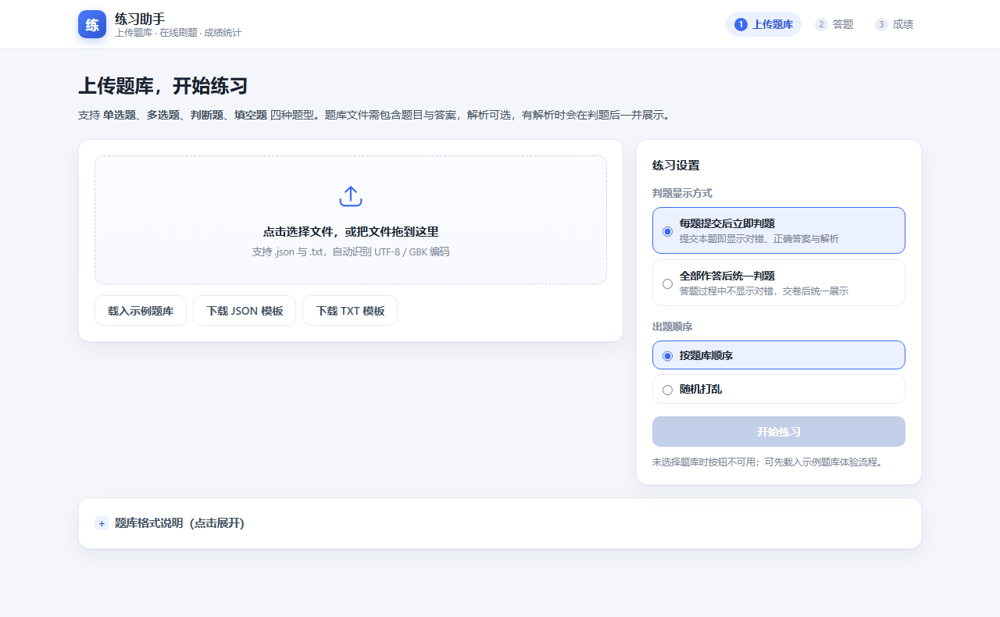
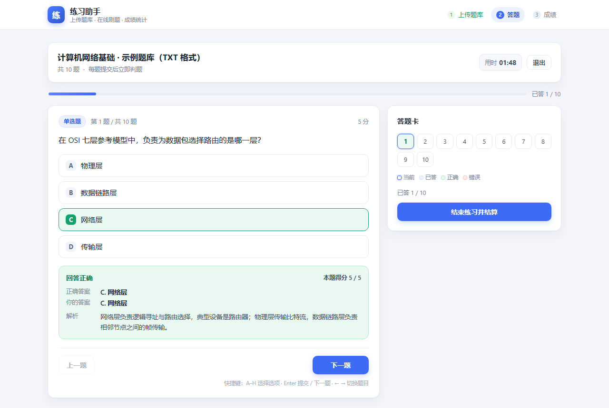
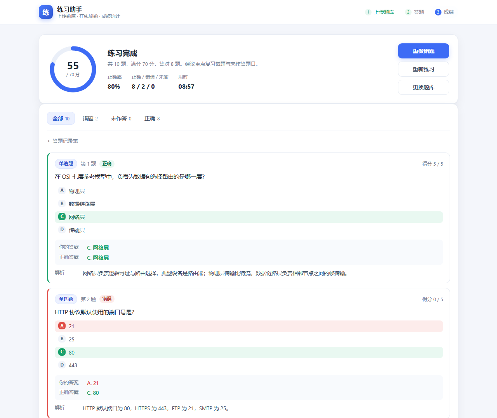

# 练习助手 · Practice Assistant


> 上传一份题库文件，立刻开始刷题。
>
> 纯前端的网页版练习助手：不装环境、不连后端、不注册账号，双击 `index.html` 就能用。支持单选、多选、判断、填空四种题型，两种判题节奏，练完直接出成绩、错题和解析。



| 答题 · 每题提交后立即判题 | 成绩 · 总分、正确率与逐题解析 |
| :---: | :---: |
|  |  |

---

## 核心特性

- **题库就是一个文件** —— 支持 JSON 与 TXT 两种格式，一个文件装完整套题：题干、选项、答案、解析、分值。格式说明见[下文](#题库格式说明)，也可以直接点页面里的「下载 JSON 模板 / TXT 模板」拿样例。
- **四种题型全覆盖** —— 单选题、多选题、判断题、填空题。填空题支持多个空，每个空还可以配置多个可接受答案（如「IP地址」或「IP 地址」都算对）。
- **两种判题节奏** —— ① 每题提交后立即判题，当场看到对错、正确答案和解析；② 全部作答完再统一判题，答题过程不受打扰。
- **成绩与错题复盘** —— 总分/满分、正确率、正确/错误/未作答数量、用时一目了然；「全部 / 错题 / 未作答 / 正确」四类筛选，逐题回看你的答案、正确答案与解析；支持一键「重做错题」。
- **顺手的小细节** —— 答题卡跳题、进度条、计时器、键盘快捷键（`A`–`H` 选择、`Enter` 提交/下一题、`←` `→` 切题）、交卷前对未答题二次确认。
- **零依赖零构建** —— 原生 HTML/CSS/JavaScript，没有框架、没有打包工具、没有 CDN 依赖，断网也能跑；数据全部留在浏览器内存里，不上传任何内容。

## 快速开始

**方式一：直接打开**

双击 `index.html`，用 Chrome / Edge / Firefox / Safari 打开即可。

**方式二：本地服务器（推荐）**

```bash
# 在项目根目录执行任意一种
python -m http.server 8765
npx serve .
```

然后访问 `http://127.0.0.1:8765/`。

**没有题库？** 点击页面上的「载入示例题库」，会加载内置的 10 道示例题（四种题型齐全，含解析），可先跑一遍完整流程；也可以点「下载 JSON 模板 / TXT 模板」拿到格式样例，改成自己的题。

---

## 题库格式说明

支持 **JSON** 与 **TXT** 两种格式，任选其一。JSON 结构严谨、字段可扩展，推荐使用；TXT 便于手工编写，按固定关键字排版即可。

### 通用字段

| 字段（JSON） | TXT 关键字 | 必填 | 说明 |
| --- | --- | --- | --- |
| `type` | `[单选]` `[多选]` `[判断]` `[填空]` 或 `题型：` | 是 | `single` / `multiple` / `judge` / `blank`，也可直接写中文「单选题」等 |
| `stem` | `题干：` / `题目：` | 是 | 题干文本，可以多行 |
| `options` | `A. xxx` / `B. xxx` … | 选择题必填 | 判断题无需填写（自动生成「正确 / 错误」两个选项） |
| `answer` | `答案：` | 是 | 见下方各题型的写法 |
| `explanation` | `解析：` | 否 | 解析文本；没有解析时，界面不会出现解析区 |
| `score` | `分值：` | 否 | 本题分值，缺省为 **5 分** |

### 各题型的答案写法

| 题型 | JSON 写法 | TXT 写法 | 判题规则 |
| --- | --- | --- | --- |
| 单选题 | `"answer": "C"` | `答案：C` | 完全一致 |
| 多选题 | `"answer": ["A","C"]` 或 `"AC"` 或 `"A、C"` | `答案：AC` / `答案：A、C` | 选项集合完全一致，少选、多选、错选均判错 |
| 判断题 | `"answer": true` / `"answer": "错误"` | `答案：正确` / `答案：错` / `答案：√` | 对/错、真/假、T/F、√/×、A/B 均可识别 |
| 填空题 | `"answer": "32"` 或 `["北京","上海"]` | `答案：32` | 忽略大小写、空格与常见标点后完全一致 |

### JSON 格式

顶层可以是对象（推荐，可带标题与描述），也可以直接是题目数组。

```json
{
  "title": "计算机网络基础",
  "description": "第一章～第三章",
  "questions": [
    {
      "type": "single",
      "stem": "HTTP 协议默认使用的端口号是？",
      "options": ["A. 21", "B. 25", "C. 80", "D. 443"],
      "answer": "C",
      "explanation": "HTTP 默认端口 80，HTTPS 为 443，FTP 为 21，SMTP 为 25。",
      "score": 5
    },
    {
      "type": "multiple",
      "stem": "下列属于 TCP 协议特点的是？",
      "options": { "A": "面向连接", "B": "提供可靠传输", "C": "无连接", "D": "提供流量控制" },
      "answer": ["A", "B", "D"],
      "explanation": "TCP 面向连接、可靠、有序，并提供流量控制与拥塞控制。",
      "score": 10
    },
    {
      "type": "judge",
      "stem": "UDP 协议在发送数据前需要先建立连接。",
      "answer": false,
      "explanation": "UDP 是无连接协议，发送前不需要握手。",
      "score": 5
    },
    {
      "type": "blank",
      "stem": "TCP 建立连接需要经过____次握手，断开连接需要经过____次挥手。",
      "answer": ["三", "四"],
      "explanation": "三次握手确认双方收发能力，四次挥手断开连接。",
      "score": 10
    }
  ]
}
```

`options` 的几种写法都支持，可以混用：

```json
"options": ["A. 21", "B. 25"]                  // 带字母前缀
"options": ["21", "25"]                        // 不带前缀，自动按 A/B 编号
"options": [{ "key": "A", "text": "21" }]      // 对象形式
"options": { "A": "21", "B": "25" }            // 映射形式
```

### TXT 格式

规则很简单：**用 `[题型]` 声明题型，每题包含题干、选项（若有）、`答案：`，题与题之间用空行分隔。**

```
# 计算机网络基础（TXT 格式）
# 以 # 开头的行是标题或注释，不会进入题目

[单选]
1. HTTP 协议默认使用的端口号是？
A. 21
B. 25
C. 80
D. 443
答案：C
分值：5
解析：HTTP 默认端口 80，HTTPS 为 443。

2. 在 OSI 七层模型中，负责路由选择的是哪一层？
A. 物理层
B. 数据链路层
C. 网络层
D. 传输层
答案：C

[多选]
3. 下列属于 TCP 特点的是？
A. 面向连接
B. 提供可靠传输
C. 无连接
D. 提供流量控制
答案：ABD
分值：10
解析：无连接是 UDP 的特点。

[判断]
4. UDP 在发送数据前需要先建立连接。
答案：错
分值：5

[填空]
5. IPv4 地址长度为____位，IPv6 地址长度为____位。
答案：32||128
分值：10
解析：两空需全部答对才得分。

6. DNS 的主要作用是把域名解析为____。
答案：IP地址|IP 地址
分值：5
```

**书写要点**

- `#` 开头的行 → 标题（第一处）或注释（其后所有），不会当成题目。
- `题干：` / `题目：` 可省略，但省略时请给题目加编号（`1.` `2.` `第3题`），否则程序依赖空行判断题目边界。
- 选项必须带分隔符：`A.` `A、` `A:` `A）` `(A)` 均可；`A 21`（只有空格）不被识别。
- 题干、选项、解析都支持**多行续写**：紧跟在上一行的内容会自动拼接（题干内换行会保留）。
- 支持单题声明题型：在题干前写 `题型：多选`。

### 填空题细则

| 场景 | 写法 | 说明 |
| --- | --- | --- |
| 一个空 | `答案：北京` | |
| 一个空、多种正确写法 | `答案：IP地址\|IP 地址` | 竖线 `\|` 分隔同一空的可接受答案 |
| 多个空 | `答案：32\|\|128` | 双竖线 `\|\|` 分隔不同的空 |
| 多空 + 多解 | `答案：32\|三十二\|\|128\|一百二十八` | 先按 `\|\|` 切空，再按 `\|` 切可接受答案 |

JSON 中对应写法：`"answer": "32||128"`、`"answer": ["32","128"]` 或 `"answer": [["32","三十二"], ["128","一百二十八"]]`。

判题时忽略大小写、空格、常见中英文标点，所以「IP 地址」「ip地址」「IP地址。」都会被判对。

### 解析与容错

- **解析是可选的**：没有 `explanation` 的题目，判题后只显示正确答案，不出现解析区。
- 单题出错不会影响整份题库：缺题干、缺答案、答案字母不在选项范围内等问题会跳过该题，并在页面上以黄色提示条列出具体位置。
- 支持的编码：UTF-8（含 BOM）、GBK（Excel / 记事本常见导出编码）、UTF-16LE。

---

## 项目结构

```
Practice Assistant/
├── index.html            页面结构（上传 / 答题 / 成绩 三个视图）
├── css/
│   └── style.css         全部样式
├── js/
│   ├── parser.js         题库解析 + 判题逻辑（不依赖 DOM，可单独测试）
│   ├── sample-data.js    内置示例题库（同时作为模板下载源）
│   └── app.js            界面交互、答题流程、成绩统计
├── assets/               README 用截图
├── LICENSE               GPL-3.0
└── README.md
```

## 实现要点

- **解析层与界面层分离**：`parser.js` 只负责「文本 → 标准题目对象」，暴露 `parseText` / `parseJSON` / `parseFile` / `gradeQuestion` 等函数，不碰 DOM，可直接在 Node 里跑单元测试。
- **统一题目模型**：

  ```js
  {
    id: 'q1',
    type: 'single' | 'multiple' | 'judge' | 'blank',
    stem: '题干',
    options: [{ key: 'A', text: '选项内容' }],
    answers: ['A'],           // 判断题：['T'] / ['F']；填空题：[['32'], ['128']]
    explanation: '解析',
    score: 5
  }
  ```

- **判题**：单选/判断按值比较；多选按排序后的字母串比较（必须完全一致）；填空逐空比对，任一个空为空即视为未作答。
- **成绩**：得分 = 各题得分之和；正确率 = 答对题数 ÷ 总题数（多选分值不等时，正确率与得分率会有差异，两者都会展示）。
- **状态**：全部在内存中维护，刷新页面即清空，不上传任何数据。

## 常见问题

**Q：题目带图片怎么办？**
当前版本按纯文本渲染。可将图片链接写进题干（如 `题干：如图 https://...`），或把图片放在项目目录用相对路径引用——但渲染层是文本节点，不会解析 HTML，如需图文题可改造 `parser.js` 的输出结构。

**Q：一份题库能有多少题？**
纯前端渲染，几千题无明显压力；答题卡会自动换行平铺。

**Q：可以改判题规则吗？**
可以。多选当前为「全对才得分」，如需「少选得半分」，修改 `parser.js` 中 `gradeQuestion` 的多选分支即可；`app.js` 里 `submitCurrent` / `finish` 按 `correct` 布尔值计分，可改为按比例返回分值。

**Q：数据会被上传吗？**
不会。没有后端、没有埋点、没有网络请求，题库解析与答题记录全部在浏览器本地完成，刷新即清空。

## 许可证

[GPL-3.0](LICENSE)
